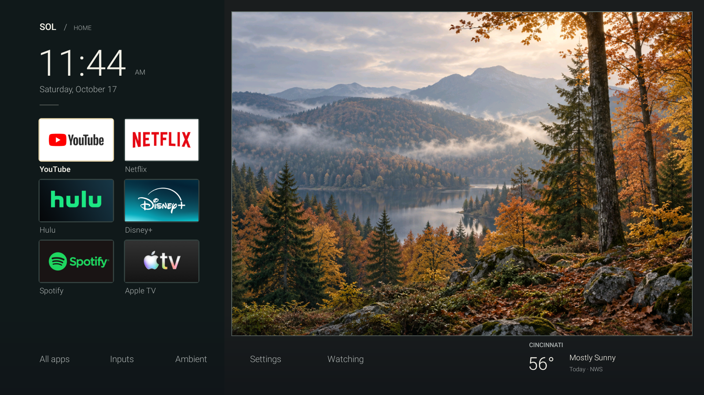
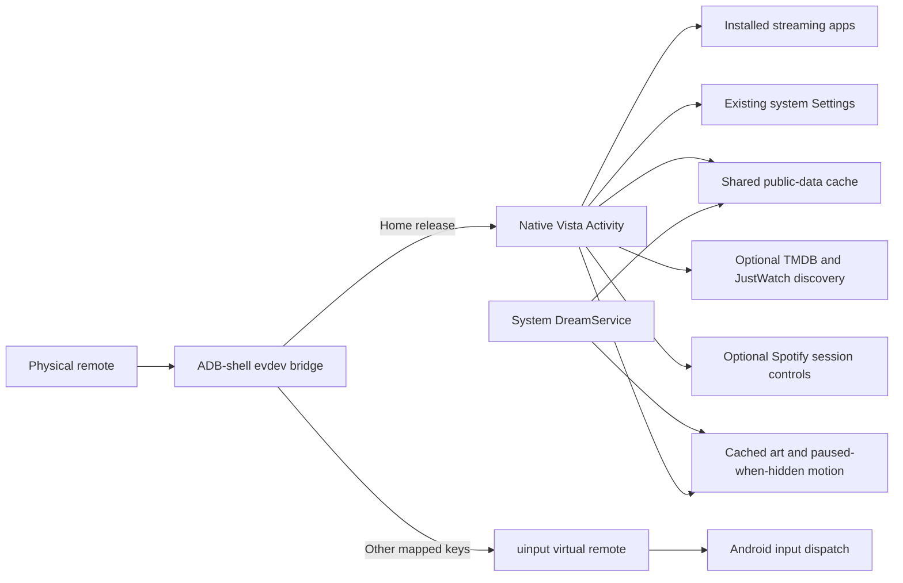

# Vista

[](https://github.com/Griff2325/vista/actions/workflows/build.yml)

A native Android TV dashboard and experimental direct-Home input bridge, built and tested on a Panasonic Fire TV.



Vista explores two practical problems: making a custom television interface feel responsive on limited hardware, and getting the physical Home button back to that interface without briefly showing Fire TV Home. The project combines native Android rendering, lifecycle-aware ambient effects, on-device performance measurement, and a small Linux input bridge.

**Status:** working device-specific prototype. Physical remote Home and tested navigation buttons work through the bridge. **Automatic bridge startup after a full TV reboot is still unresolved.** This is not a universal Fire TV replacement, an alternative TV firmware, or a demonstrated root method.

## What it does

- A scrollable remote-navigable Home grid: YouTube, Netflix, Hulu, Disney+, Spotify, Apple TV, Explore, Spotify vibes, All apps, Inputs, Ambient, Settings and Watching. Installed app banners supply service logos; reading shortcuts stay anchored beneath the grid.
- Native pixel-art lake viewed through one open window, with a smooth room surround and bottom utility console. After two minutes idle it expands into a fullscreen scene with a clock, winter countdown and information cards; TV sleep is configured to 60 minutes.
- Swaying trees, expanding lake ripples, five cloud silhouettes, and sparse weather effects driven by Cincinnati NWS observations. Offline Cincinnati solar lighting handles the day/night cycle.
- A sparse [world outside the window](docs/world-outside.md): passing birds, a visiting fox and a distant winter snowboarder. Sightings follow daylight and calm Cincinnati weather, with a settings toggle.
- A native [SwiftUI iPhone companion](companion/ios/README.md), with an opt-in TV service and local QR/code pairing, Vista navigation, typed Explore searches, app shortcuts, Spotify transport and scene controls. Fire OS requires the physical Home button to return from streaming apps.
- Four [calendar seasons and holiday occasions](docs/seasons.md): spring blossoms/butterflies, summer greens/fireflies, original autumn leaves and snowy winter with a foreground snowboard. Automatic holiday accents include Halloween characters, harvest gourds, Christmas lights/gifts and small celebration fireworks. Settings provides previews, an accents toggle, upcoming dates and private annual events.
- Readable MIT News/BBC publisher briefs, one next-seven-days Cincinnati list combining shows, markets, sports and recent food reporting, detailed Cincinnati weather, plus two 24–72-hour snow estimates beneath weather. Default editable points are Perfect North and Timberline Mountain, West Virginia.
- Side-by-side [Codex and Claude Code allowance cards](docs/coding-usage.md) on Home and below the screensaver widgets, with reset times, saved-reading labels and separate Mac-today recorded token totals. An optional Mac helper forwards only normalized usage observations over the existing ADB connection; provider credentials remain on the Mac. Home weather includes native condition icons and the next reported high/low.
- Explore combines optional TMDB movie/TV search with US JustWatch availability and selected-service/genre discovery. A personal API credential is required for catalog results; installed-app shortcuts work without it. Sign-ins, entitlement, YouTube's catalog and private viewing histories are not aggregated.
- Spotify vibes opens default playlists or saved Spotify content links, with an optional compact player using actual Spotify sessions on the TV. Playback controls require explicit Android notification access; playlist links do not guarantee autoplay.
- Optional [Hulu ad muting](docs/hulu-ad-muting.md) detects its visible Ad badge locally using Android 11+ accessibility access. It mutes detected breaks and restores sound afterward; it does not skip the ad countdown. Starts disabled.
- Reusable scene textures, approximately 30 fps vsync pacing, and paused-when-hidden animation. No WebView or fullscreen video player.
- All-apps picker, TV input picker and existing TV Settings. Read-only Android Watch Next integration is present, but no installed app shared progress in the tested setup.
- Optional local ADB-shell supervisors for direct physical Home interception and the device-specific system screensaver route. Both need bootstrapping after a full TV reboot.

## Measured on the TV

| Historical short navigation sample | WebView prototype | Pixel Autumn 0.4 |
|---|---:|---:|
| Janky frames | 62.12% | 0% |
| p90 frame time | 42 ms | 5 ms |
| Main-process PSS | 163,333 KiB | 63,270 KiB |

The 0.4 main process used about 61% less PSS in these samples. The old separate WebView renderer is excluded. Frame populations differ because the implementations animate differently; these are short samples on one device, not a whole-TV benchmark. During a three-second hidden-scene check, Vista rendered no additional frames. Version 0.5 measured zero jank across 834 navigation frames (p90 6 ms), with a higher cold Home PSS snapshot of 92,669 KiB after adding sharper scene caches and live/media features. See [validation and methods](docs/validation.md) and the [measurement summaries](docs/evidence/measurements.json).

## Architecture



The bridge runs locally on the TV; the laptop is not in the per-button path. It uses permissions available to the already authorized ADB shell on the tested firmware. Ordinary apps do not have these permissions. Amazon's launcher and privileged TV settings components remain installed and enabled. [Bridge design, compatibility, startup, and recovery](bridge/README.md).

[Prism](https://github.com/Griff2325/prism) is the separate reusable lighting harness. It currently accepts synthetic or piped zone colors and controls selected compatible Govee LAN lights; Vista frame input and physical room calibration are not yet integrated.

## Build

Requirements: JDK 17+, Python 3, Android SDK platform 34 and build-tools 34.0.0; Clang with an ARM target for the optional bridge. Install Android SDK components using the official [sdkmanager](https://developer.android.com/tools/sdkmanager):

```sh
sdkmanager "platforms;android-34" "build-tools;34.0.0"
export ANDROID_SDK_ROOT=/path/to/your/android-sdk
bash scripts/build-app.sh
bash scripts/test-sky.sh
bash scripts/build-bridge.sh
```

If tools are stored separately, set `ANDROID_BUILD_TOOLS` and `ANDROID_JAR` instead. Set `JAVA_HOME` if Java is not on your PATH. Outputs go to ignored `build/`.

The app build creates an ignored disposable development key under `.local/signing/`. It does not include or use the private key for the existing TV installation. A new developer build cannot update an APK signed with a different key. Preserve the original private key for in-place updates; do not uninstall an existing installation solely to bypass that mismatch. No signed production/installed-device APK is published here.

After authorizing your own ADB target, a fresh compatible installation can be installed with:

```sh
adb -s YOUR_ADB_SERIAL install build/sol-home-debug.apk
adb -s YOUR_ADB_SERIAL shell am start -n com.griffin.solhome/.MainActivity
```

Declaring HOME in the manifest does not override Amazon's Home resolver on the tested firmware. The bridge is a separate installation with [device-specific instructions](bridge/README.md). It currently requires restarting over ADB after a full TV reboot.

CI builds and verifies the development APK and compiles the bridge. It does not connect to a TV or prove real remote behavior.

The existing `com.griffin.solhome` package, component names, bridge virtual-device name and build filenames are retained from the original installation for compatibility. User-facing branding is Vista.

## Project notes

- [Screensaver setup, live data and recovery](docs/screensaver.md)
- [Explore and Spotify setup](docs/media.md)
- [Coding usage sync and freshness](docs/coding-usage.md)
- [Architecture and implementation decisions](docs/architecture.md)
- [Validation and performance evidence](docs/validation.md)
- [Known limitations and next priorities](docs/roadmap.md)
- [Seasonal scene implementation, assets, and prompts](docs/pixel-autumn/README.md)
- [Seasons, holiday windows, previews and annual events](docs/seasons.md)
- [Original illustrated scene concepts](docs/design-concepts/2026-10-17/README.md)
- [Preserved prototype snapshots](prototypes/README.md)
- [Changelog](CHANGELOG.md)
- [Asset and third-party acknowledgments](THIRD_PARTY_NOTICES.md)

This is Griffin Lee's AI-assisted project, developed with OpenAI Codex. Design direction, device testing feedback, and requirements came from the project owner. Implementation and investigation were assisted by Codex; landscape assets were generated with the built-in imagegen tool and their prompts are preserved. Earlier snapshots were imported when this repository was established; commit dates have not been reconstructed or backdated.
