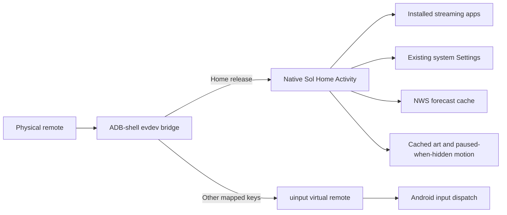

# Sol Home

[](https://github.com/Griff2325/sol-home/actions/workflows/build.yml)

A native Android TV dashboard and experimental direct-Home input bridge, built and tested on a Panasonic Fire TV.


Sol Home explores two practical problems: making a custom television interface feel responsive on limited hardware, and getting the physical Home button back to that interface without briefly showing Fire TV Home. The project combines native Android rendering, lifecycle-aware ambient effects, on-device performance measurement, and a small Linux input bridge.

**Status:** working device-specific prototype. Physical remote Home and tested navigation buttons work through the bridge. **Automatic bridge startup after a full TV reboot is still unresolved.** This is not a universal Fire TV replacement, an alternative TV firmware, or a demonstrated root method.

## What it does

- Six remote-navigable logo tiles: YouTube, Netflix, Hulu, Disney+, Spotify, and Apple TV. Logos come from installed app banners/icons at runtime.
- All-apps picker, TV input picker, ambient scene mode, and a direct route to existing system Settings.
- Native Canvas dashboard with a large autumn forest window, slow drifting mist/cloud overlays, and occasional leaves suggesting wind. This is a still base image with procedural overlays, not a video or fully simulated forest.
- A small cached motion texture, a retained static interface, and a 12 fps transparent animation layer that stops when the Activity pauses.
- Clock/date and cached National Weather Service forecasts. Cincinnati city-center coordinates are the current fixed example location; this is not GPS or automatic location detection.
- Read-only Android Watch Next integration. No installed app shared progress in the tested setup, so cross-platform Continue Watching remains unavailable.
- An optional ADB-shell input bridge that intercepts physical Home before Android launches Amazon Home, while forwarding the other mapped remote keys.

## Measured on the TV

| Short navigation sample | WebView prototype | Current native fall dashboard |
|---|---:|---:|
| Janky frames | 62.12% | 0.88% |
| p90 frame time | 42 ms | 5 ms |
| Main-process PSS | 163,333 KiB | 57,570 KiB |

The current main process uses about 65% less PSS in these samples. The old separate WebView renderer is excluded. Frame populations differ because the implementations animate differently; these are short samples on one device, not a whole-TV benchmark. During a three-second hidden-scene check, Sol rendered no additional frames. See [validation and methods](docs/validation.md) and the [measurement summaries](docs/evidence/measurements.json).

## Architecture



The bridge runs locally on the TV; the laptop is not in the per-button path. It uses permissions available to the already authorized ADB shell on the tested firmware. Ordinary apps do not have these permissions. Amazon's launcher and privileged TV settings components remain installed and enabled. [Bridge design, compatibility, startup, and recovery](bridge/README.md).

## Build

Requirements: JDK 17+, Python 3, Android SDK platform 34 and build-tools 34.0.0; Clang with an ARM target for the optional bridge. Install Android SDK components using the official [sdkmanager](https://developer.android.com/tools/sdkmanager):

```sh
sdkmanager "platforms;android-34" "build-tools;34.0.0"
export ANDROID_SDK_ROOT=/path/to/your/android-sdk
bash scripts/build-app.sh
bash scripts/build-bridge.sh
```

If tools are stored separately, set `ANDROID_BUILD_TOOLS` and `ANDROID_JAR` instead. Set `JAVA_HOME` if Java is not on your PATH. Outputs go to ignored `build/`.

The app build creates an ignored disposable development key under `.local/signing/`. It does not include or use the private key for the existing TV installation. A new developer build cannot update an APK signed with a different key. Preserve the original private key for in-place updates; do not uninstall an existing installation solely to bypass that mismatch. No signed production/installed-device APK is published here.

After authorizing your own ADB target, a fresh compatible installation can be installed with:

```sh
adb -s YOUR_ADB_SERIAL install build/sol-home-debug.apk
adb -s YOUR_ADB_SERIAL shell am start -n com.griffin.solhome/.MainActivity
```

Declaring HOME in the manifest does not override Amazon's Home resolver on the tested firmware. The bridge is a separate installation with [device-specific instructions](bridge/README.md). It currently requires restarting over ADB after a full TV reboot.

CI builds and verifies the development APK and compiles the bridge. It does not connect to a TV or prove real remote behavior.

## Project notes

- [Architecture and implementation decisions](docs/architecture.md)
- [Validation and performance evidence](docs/validation.md)
- [Known limitations and next priorities](docs/roadmap.md)
- [Illustrated scene concepts awaiting selection](docs/design-concepts/2026-10-17/README.md)
- [Preserved prototype snapshots](prototypes/README.md)
- [Changelog](CHANGELOG.md)
- [Asset and third-party acknowledgments](THIRD_PARTY_NOTICES.md)

This is Griffin Lee's AI-assisted project, developed with OpenAI Codex. Design direction, device testing feedback, and requirements came from the project owner. Implementation and investigation were assisted by Codex; landscape assets were generated with the built-in imagegen tool and their prompts are preserved. Earlier snapshots were imported when this repository was established; commit dates have not been reconstructed or backdated.
