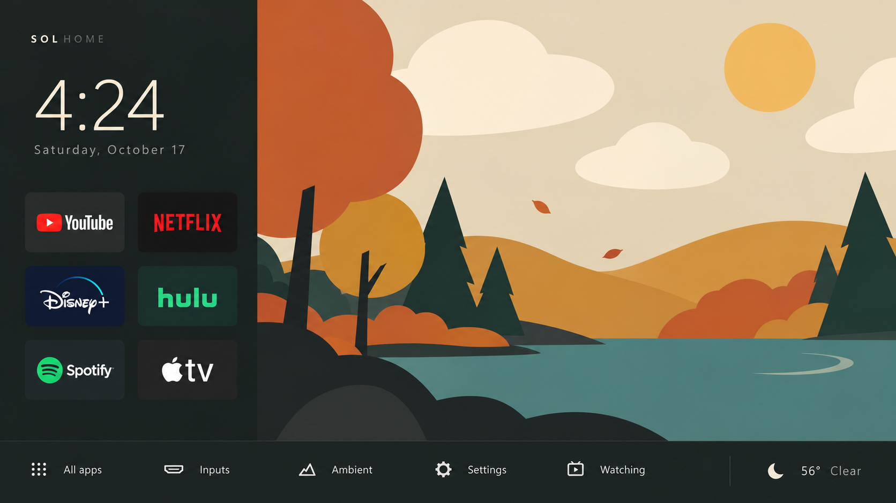
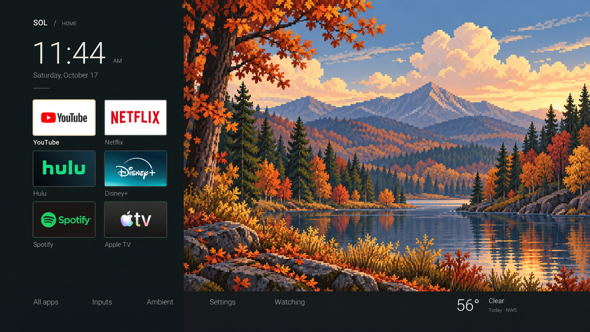
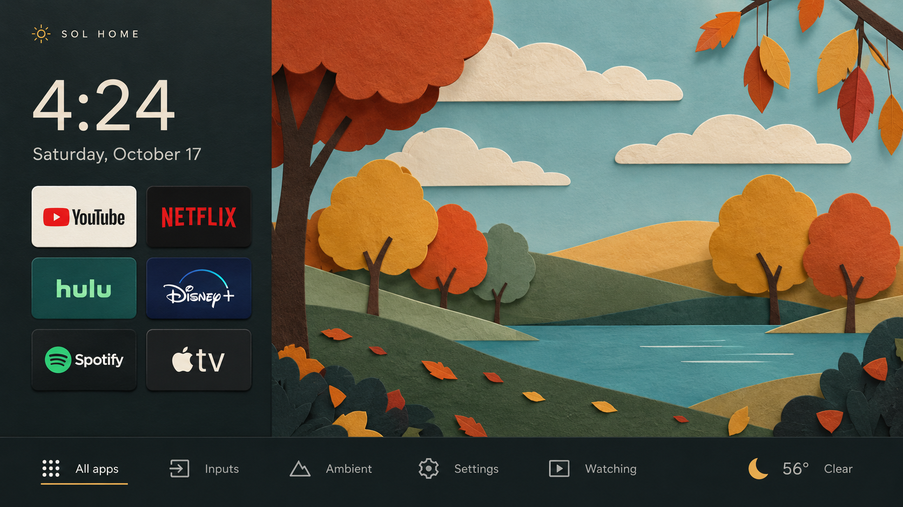
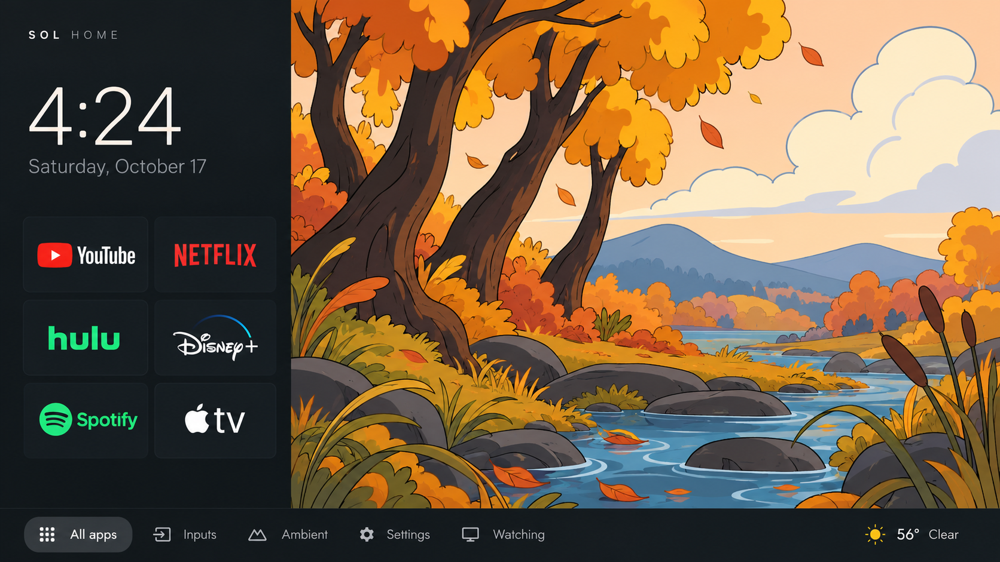

# Illustrated scene concepts — October 17, 2026

Four original full-screen concepts for replacing the photographic forest. Each image shows the complete launcher composition: a left app pane, bottom controls, and a frameless illustrated autumn scene.

These are generated approval previews, not screenshots of implemented software or animation assets. The owner selected **Pixel Autumn**. Separate runtime pieces, motion, and a later open-window room layout are now implemented; see [the current scene](../../pixel-autumn/README.md). Minor text/logo variations in generated concepts do not redefine app order or runtime behavior.

## 1. Bold shapes

Large flat-color tree crowns, broad hills, cloud silhouettes, and spare water ripples. Potential motion: swaying crown groups, drifting clouds, occasional leaves, and simple ripple strokes. This direction can translate into a small set of native paths and cached shapes.

## 2. Pixel autumn

An original cozy pixel-art forest lake, with clear layered silhouettes and warm autumn colors. Potential motion: pixel cloud layers, small water shimmer/ripple sprites, leaf-cluster shifts, and drifting leaves. A low-resolution layer approach is possible; full-screen frame sequences are not planned.

## 3. Paper world

Large cardstock tree/cloud cutouts, restrained shadows and a layered pond. Potential motion: gently pivoting trees and hanging leaves, cloud-strip translation, and water highlights. Paper texture and contact shadows could be baked into small reusable cutouts.

## 4. Animated forest

A warm hand-drawn cartoon grove with bold contours, curved trunks, a stream and foreground reeds. Potential motion: separate bough/leaf clusters, reed tufts, clouds, stream highlights, and a few individual leaves.

## Next step and constraints

Pixel Autumn was selected and its independent pieces now animate as reusable layers. The other three remain concepts. Keep a static UI separate from moving art, pause work while the launcher is hidden, bound texture sizes, and measure memory/frame time on the actual TV. Simpler visual style alone does not prove lower memory or faster rendering; layer dimensions and rendering behavior determine the cost.

Generated using the built-in image_gen tool. Exact final prompts and the pixel option's layout reference are recorded in [prompts.json](prompts.json). The overly photographic first drafts of three directions were discarded in favor of these distinctly illustrated concepts.
