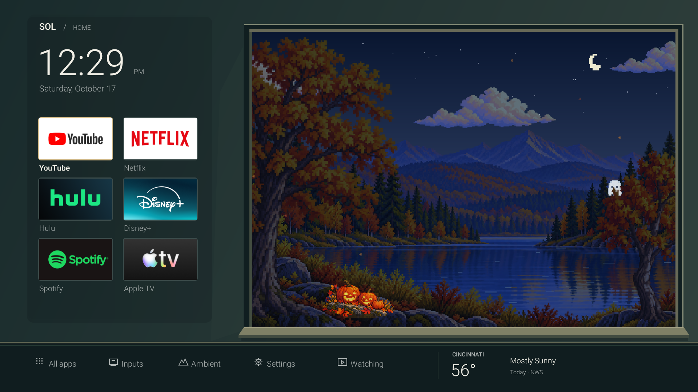

# Pixel Autumn — open-window scene

The owner selected Pixel Autumn from the [four illustrated concepts](../design-concepts/2026-10-17/README.md). The implemented dashboard treats the landscape as a view outdoors: one uninterrupted opening, deep timber reveal/sill, a smooth recessed app rail with no row dividers, and a shallow console for utilities and forecast. The surrounding surfaces use smooth, simple native Canvas drawing, retained separately from scene motion. No screenshot from the visual inspiration is bundled.

## Artwork and generation

Generated with the **built-in image_gen tool**, using the approved Pixel Autumn concept as a palette/style reference. Exact asset prompts and transparency requirements are in [asset-prompts.json](asset-prompts.json). Assets are original generated illustrations; installed application logos are loaded at runtime.

| Asset | Runtime purpose |
|---|---|
| [Terrain](../../app/assets/pixel-autumn/terrain.png) | 480x336 cached mountains, distant forest, lake, and banks; transparent sky |
| [Left tree](../../app/assets/pixel-autumn/tree-left.png) | Rooted mesh sway; 144x192 logical pixels |
| [Right tree](../../app/assets/pixel-autumn/tree-right.png) | Rooted mesh sway; 112x152 logical pixels |
| [Cloud](../../app/assets/pixel-autumn/cloud.png) | 192x64 logical pixels reused for drifting clouds |
| [Halloween](../../app/assets/pixel-autumn/halloween.png) | 100x67 pumpkin cutout, October only |

Moving tree/cloud textures are nearest-upscaled 3x once, then sampled with filtering during fractional movement. The chunky design remains visible while travel avoids whole-pixel jumps. Including two tiny native ghost sprites, retained scene bitmaps total **2,757,040 bytes (~2.63 MiB)**. Source PNG dimensions/file sizes are not runtime decoded-memory costs.

## Motion and lifecycle

Choreographer paces scene invalidation at about 30 fps on the tested 60 Hz TV. Rooted mesh deformation gives trees continuous sway and mild intermittent gusts. Clouds translate smoothly; water reuses the same terrain bitmap through a lake mask and mesh, with moving ripple highlights. A few leaves and nighttime bats add sparse motion. These are selected animated layers, not a complete forest or fluid simulation.

The friendly ghost follows a bounded continuous path through sky, trees, and lake, bobs and blinks, and passes behind foreground trees. Ghost, pumpkins, and bats are limited to October in Cincinnati. Ambient mode hides app controls but keeps the view contained. The Activity stops scene callbacks on pause; no video, decoded frame sequence, or per-frame image decoding is used.

## Cincinnati lighting

[CincinnatiSky.java](../../app/src/com/griffin/solhome/CincinnatiSky.java) calculates approximate solar elevation offline using the [NOAA equations](https://gml.noaa.gov/grad/solcalc/solareqns.PDF), at 39.1031 N, 84.5120 W. Sky, terrain, and cloud tint blend through day, dawn/dusk, and night. The moon/stars are decorative; lunar phase is not calculated. Lighting follows the TV timestamp; local dates, clock, and October boundaries use America/New_York. It does not depend on the weather API.

`bash scripts/test-sky.sh` checks seasonal elevation, midnight darkness, dawn/dusk, the October/November boundary, timezone independence, and DST continuity. Developer-only `sol.preview.epoch` intent extras preview scene dates without changing the system clock or preferences; a normal Home intent clears the override. Test captures exercise day, dusk, night, and November, then restore live time.

[Validation and performance](../validation.md) records device measurements and their limits.
